# TalentFlow

[](https://github.com/bechir76/talentflow/actions/workflows/ci.yml)

**A GDPR-compliant applicant tracking system with AI-assisted CV screening, built for European companies.**

Recruiters publish jobs, candidates apply with their CV on a public career page, an AI assistant suggests how well
each CV matches the job, and the hiring team moves candidates through a Kanban pipeline, schedules interviews and
collects scorecards. Privacy is built in: explicit consent, data export, the right to erasure, automatic retention
and an audit trail. The AI never decides; it only suggests, and a person makes every decision.

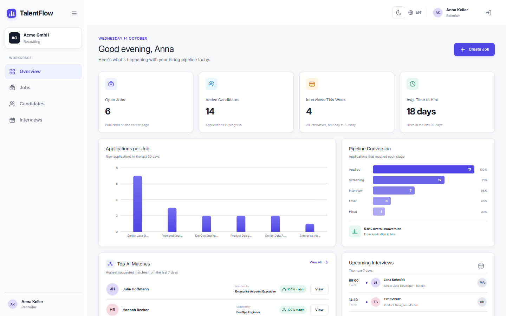

## Contents

- [Features](#features)
- [Quick start](#quick-start)
- [Architecture](#architecture)
- [Tech stack](#tech-stack)
- [Design decisions](#design-decisions)
- [GDPR and EU AI Act](#gdpr-and-eu-ai-act)
- [Local development](#local-development)
- [Configuration](#configuration)
- [Testing and quality](#testing-and-quality)
- [API documentation](#api-documentation)
- [Project structure](#project-structure)
- [Screenshots](#screenshots)
- [Limitations and next steps](#limitations-and-next-steps)

## Features

| Role | What they can do |
|---|---|
| **Candidate** | Browse the public career page, read the privacy policy, apply with a PDF CV and explicit consent, follow every application with a stage stepper, download all their data as JSON, see their consent history and delete their data |
| **Recruiter** | Create, publish, close and reopen jobs; see applications with AI suggestions; view CVs in the browser; move candidates on a drag-and-drop Kanban board; schedule interviews and invite interviewers; dashboard with live KPIs and charts |
| **Hiring manager** | See the interviews they are invited to in a week calendar, open those candidates (and only those), and submit a scorecard (technical, communication, culture fit from 1 to 5, recommendation) |
| **Admin** | Everything a recruiter can do, plus user and role management (via Keycloak), the data retention policy and the audit log |

Across the app:

- **AI CV screening:** asynchronous, with strict JSON validation, an offline fallback and personal data removed before anything is sent.
- **E-mails:** candidates are notified of stage changes and interview invitations, in English and German.
- **Privacy policy:** a public `/privacy` page (English and German) explains what is stored, why, for how long and
  which rights candidates have. It shows the current policy version and retention period from the API and is linked
  from the footers, the consent checkbox and the candidate's privacy page.
- **Bilingual UI:** English and German, switchable at any time and also passed to the Keycloak login page.
- **Design:** the UI follows the original Figma design: indigo `#4F46E5`, Inter (self-hosted, no font CDN), light
  and dark mode.

## Quick start

Requirements: Docker with Docker Compose.

```bash
cp .env.example .env          # change the passwords if you like
docker compose up --build
```

The first start builds the images, imports the Keycloak realm, runs the database migrations and fills the
database with fictional demo data (`SEED_DEMO_DATA=true`).

| What | URL |
|---|---|
| Web app | http://localhost:3000 |
| Public career page | http://localhost:3000/careers |
| API documentation (Swagger UI) | http://localhost:8080/swagger-ui.html |
| Keycloak admin console | http://localhost:8180 (user and password from `.env`) |
| Mailpit (all outgoing e-mail) | http://localhost:8025 |

**Demo accounts** (password `demo1234` for all):

| Account | Role |
|---|---|
| `candidate@talentflow.dev` | Candidate with two applications |
| `recruiter@talentflow.dev` | Recruiter (Anna Keller) |
| `manager@talentflow.dev` | Hiring manager (Martin Richter), invited to several interviews |
| `admin@talentflow.dev` | Admin |

> New candidate accounts must confirm their e-mail address before they set a password: the verification mail
> arrives in Mailpit. Passwords need at least 10 characters including a digit (the demo accounts are exempt).
>
> If a port is already taken on your machine, change `BACKEND_PORT`, `FRONTEND_PORT` or `KEYCLOAK_PORT` in `.env`
> and run `docker compose up --build -d` again; the Keycloak URL and redirect URLs follow the ports.
> To start again with a clean database: `docker compose down -v`.

## Architecture

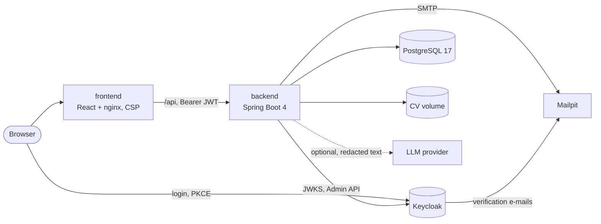

The backend is a modular monolith with a **hexagonal (ports and adapters)** structure. Each module
(`job`, `application`, `candidate`, `ai`, `pipeline`, `interview`, `gdpr`, `audit`, `user`, `shared`) has
`domain`, `application` and `infrastructure` packages; a separate `demo` package seeds fictional data. Domain
rules live in the entities (for example "hired only from offer"), use cases in application services, and
everything technical (REST, JPA, Keycloak, LLM, mail, files) in adapters behind interfaces.

More diagrams (modules, data model, sequence diagrams for applying, screening, pipeline moves and erasure) are
in **[docs/architecture.md](docs/architecture.md)**.

## Tech stack

| Area | Technologies |
|---|---|
| Backend | Java 25, Spring Boot 4.1 (Spring Framework 7, Jakarta EE 11, Jackson 3), Spring Web MVC, Data JPA, Validation, Security (OAuth2 resource server), Mail, Scheduling, Flyway, PostgreSQL 17, Apache PDFBox, springdoc-openapi, `RestClient` |
| Frontend | React 19, TypeScript (strict), Vite, Tailwind CSS v4 with the design's CSS system, React Router, TanStack Query, react-hook-form + zod, dnd-kit, Recharts, react-i18next, keycloak-js |
| Identity | Keycloak 26 (realm import with roles, clients, demo users, e-mail verification and password policy) |
| Tests | JUnit 5, Mockito, Spring MockMvc, Testcontainers (PostgreSQL), JaCoCo; Vitest and React Testing Library; ESLint |
| Delivery | Docker Compose, GitHub Actions (backend, frontend and image builds on every push) |

## Design decisions

- **Hexagonal modules instead of layers per technical concern.** Business rules are testable without Spring,
  and adapters (LLM provider, CV storage, identity provider) can be swapped. Cyclic module dependencies are
  avoided with ports (for example `ApplicantCounter`, `InterviewAssignments`).
- **Keycloak with authorization code flow and PKCE.** The app never handles passwords; the login form of the
  original design became a redirect. The backend validates issuer, audience and signature and maps realm roles
  to Spring roles. User administration uses a separate service-account client whose secret is injected into
  the realm import from the environment. The realm requires verified e-mail addresses for self-registration, a
  password policy and brute-force protection; the demo users are imported with pre-hashed passwords.
- **Security headers from nginx.** A Content-Security-Policy allows scripts only from the app itself (no inline
  scripts) and Keycloak as the only other origin; the Keycloak URL is injected from the environment when the
  container starts. nosniff, frame, referrer and permissions headers are sent on every response.
- **RFC 9457 Problem Details for every error**, including 401 and 403 from the security layer, with field
  errors for validation problems. Business rule violations are 422, conflicts 409.
- **AI as a plain HTTP call with `RestClient`.** Any OpenAI-compatible chat completions API works (Mistral,
  OpenAI, Azure OpenAI, a local Ollama). Mistral is the default because it is hosted in the EU. Without an API key
  a deterministic keyword analyzer is used, so the app and all tests work offline.
- **Asynchronous screening after commit.** Applying is fast and can never fail because of the AI provider. The
  LLM call runs outside a database transaction.
- **Concurrency handled explicitly.** AI result fields are excluded from optimistic locking and updates only
  write changed columns, so a recruiter's stage change and a finishing screening never overwrite each other (this
  was caught by an integration test).
- **Row-level authorisation in the application layer.** Hiring managers only see candidates they interview;
  recruiters and admins see everything.
- **CV files outside the database** under random keys, so file names contain no personal data. A file is
  deleted again if the transaction that references it rolls back.
- **Flyway migrations only** (`ddl-auto=validate`), seeded reference data, and an optional demo seeder that
  never runs on a non-empty database.
- **Design fidelity.** The Figma export's CSS design system is kept as the single source of styling. New
  screens (career page, candidate portal, calendar, admin pages) reuse its classes and tokens.

## GDPR and EU AI Act

Recruiting is a **high-risk** use case under the EU AI Act (Annex III). TalentFlow treats AI strictly as decision
support:

| Requirement | How TalentFlow implements it |
|---|---|
| Human oversight | The AI only suggests a score, skills and a summary. It never changes a stage. Every screen with AI output shows: "AI suggestions support your decision. Final decisions are made by a human." |
| Transparency | The model name and analysis time are stored and shown with every suggestion; candidates are told about the AI screening before they apply, and its results are included in their data export |
| Robustness | The LLM must return strict JSON that is validated (score range, lists, max. 3 sentences); invalid output marks the screening as failed instead of storing it. Recruiters can re-run a screening |
| Non-discrimination | The prompt restricts the model to job-related skills and tells it to ignore protected characteristics; CV text is treated as untrusted data (prompt-injection guard) |
| Data minimisation (Art. 5(1)(c) GDPR) | Name, e-mail, phone and profile links are removed from the CV text before it is sent; only the job and the redacted text leave the system |
| Information (Art. 13) | A public privacy policy page describes the stored data, purposes, legal basis, AI screening, retention period, recipients and rights |
| Lawful basis and proof of consent (Art. 6, 7) | Applying requires an explicit, unticked consent checkbox that links to the privacy policy. Each consent is stored with timestamp and privacy policy version |
| Right of access (Art. 15) | Candidates download all their data as JSON (profile, consents, applications, stage history, interviews, AI results) |
| Right to erasure (Art. 17) | Candidates can delete their data: the profile is anonymised, CVs, cover letters, AI output, meeting links and feedback comments are removed, consents withdrawn and open applications ended. Anonymous statistics stay correct |
| Storage limitation (Art. 5(1)(e)) | Admins configure how many months rejected candidates are kept; a daily job (or "Run now") anonymises them |
| Accountability (Art. 5(2)) | Audit log for CV viewed and downloaded, data exported, candidate deleted, stage changed, retention and user changes |
| Security (Art. 32) | Token-based auth with roles and row-level rules, no passwords in the app, verified e-mail and password policy for new accounts, brute-force protection, CSP and security headers, CV files outside the database under random names, path-traversal-safe storage |

## Local development

**Backend** (JDK 25; PostgreSQL, Keycloak and Mailpit from Docker):

```bash
docker compose up -d postgres keycloak mailpit
cd backend
set -a; source ../.env; set +a                # read the same values Compose uses
DB_PASSWORD=$POSTGRES_PASSWORD SEED_DEMO_DATA=true ./mvnw spring-boot:run
# or, without any local database: run TestTalentflowApplication from the IDE (Testcontainers)
```

`application.yml` defaults to the local services (database `talentflow` on port 5432, Keycloak on 8180,
Mailpit on 1025, API on 8080). Outside Compose these variables need values:

| Variable | Why |
|---|---|
| `DB_PASSWORD` | Must match `POSTGRES_PASSWORD` from `.env`; the default `talentflow` only works if you kept that password. `DB_USERNAME`/`DB_URL` likewise if you changed `POSTGRES_USER`/`POSTGRES_DB` |
| `KEYCLOAK_ADMIN_CLIENT_SECRET` | Same value as in `.env`; without it the admin user management calls to Keycloak fail |
| `KEYCLOAK_ISSUER_URI`, `KEYCLOAK_JWK_SET_URI`, `KEYCLOAK_ADMIN_URL` | Only if `KEYCLOAK_PORT` is not 8180 |
| `SERVER_PORT` | Only if port 8080 is taken; then start the frontend with `API_PROXY_TARGET` (below) |
| `SEED_DEMO_DATA` | `true` to fill an empty database with demo data (off by default outside Compose) |

**Frontend** (Node 24):

```bash
cd frontend
npm install
npm run dev                                 # http://localhost:5173, proxies /api to localhost:8080
API_PROXY_TARGET=http://localhost:8081 npm run dev   # if the backend runs on another port
```

## Configuration

All settings come from environment variables (see [`.env.example`](.env.example)); nothing secret is committed.

| Variable | Purpose | Default |
|---|---|---|
| `POSTGRES_DB`, `POSTGRES_USER`, `POSTGRES_PASSWORD` | Database | `talentflow` / required |
| `KEYCLOAK_ADMIN_USER`, `KEYCLOAK_ADMIN_PASSWORD` | Keycloak admin console | `admin` / required |
| `KEYCLOAK_ADMIN_CLIENT_SECRET` | Secret of the backend's user-admin service account | required |
| `LLM_BASE_URL`, `LLM_API_KEY`, `LLM_MODEL` | AI provider (OpenAI-compatible). Empty key = offline analyzer | Mistral, empty, `mistral-small-latest` |
| `SEED_DEMO_DATA` | Fill an empty database with demo data | `true` in Compose |
| `COMPANY_NAME` | Hiring company shown in the staff workspace header (frontend build argument) | `Acme GmbH` |
| `BACKEND_PORT`, `FRONTEND_PORT`, `KEYCLOAK_PORT` | Host ports | 8080, 3000, 8180 |
| `PRIVACY_POLICY_VERSION` | Stored with every consent | `2026-10` |
| `RETENTION_CRON`, `TIME_ZONE` | Retention job schedule, time zone for e-mails and "this week" | `0 0 3 * * *`, `Europe/Berlin` |
| `MAIL_HOST`, `MAIL_PORT`, `MAIL_FROM` | SMTP | Mailpit |

## Testing and quality

```bash
cd backend && ./mvnw verify      # 123 tests incl. Testcontainers integration tests, JaCoCo gate (≥ 70 % lines)
cd frontend && npm test          # Vitest + React Testing Library
cd frontend && npm run lint      # ESLint (TypeScript and React hooks rules), no warnings allowed
cd frontend && npm run build     # strict type check + production build
```

- **Backend:** about 86 % line coverage. It covers unit tests for domain rules (job lifecycle, stage transitions,
  CV validation, redaction, analysis contract), Mockito tests for use cases, MockMvc tests for security and
  validation on every controller, and end-to-end integration tests against PostgreSQL for applying, screening,
  pipeline, GDPR, interviews and the demo seeder.
- **Frontend:** tests for role routing helpers, stage rules, form schemas (including GDPR consent), pagination,
  date helpers, the skills input and the CV drop zone.
- **CI:** GitHub Actions runs the backend build with Testcontainers, the frontend type check, lint, tests and build,
  and builds both Docker images on every push.

## API documentation

Swagger UI is available at `/swagger-ui.html` and the OpenAPI document at `/v3/api-docs`. Use the
**Authorize** button with an access token to try protected endpoints. All endpoints are under `/api/v1`;
`/api/v1/public/**` (career page and privacy policy facts) needs no login. Lists that can grow with use
(jobs, career page, pipeline cards, the candidate's applications, users, audit log) are paginated (`page`, `size`, `sort`).
A few small, bounded lists return a plain array: departments, interviewers, the stage history and interviews
of one application, the candidate's own consents, and the interview calendar (limited to a range of 62 days).

## Project structure

```
talentflow/
├── backend/                Spring Boot API (com.talentflow.<module>.{domain,application,infrastructure})
│   └── src/main/resources/db/migration   Flyway migrations V1–V8
├── frontend/               React app (src/features/<feature>, src/components, src/lib)
├── infra/keycloak/         realm-export.json: roles, clients, demo users
├── docs/                   architecture.md, screenshots
├── docker-compose.yml
└── .github/workflows/ci.yml
```

## Screenshots

| | |
|---|---|
| 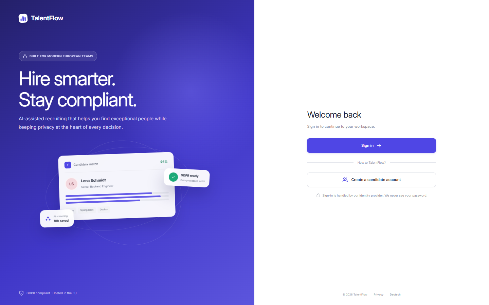 Login | 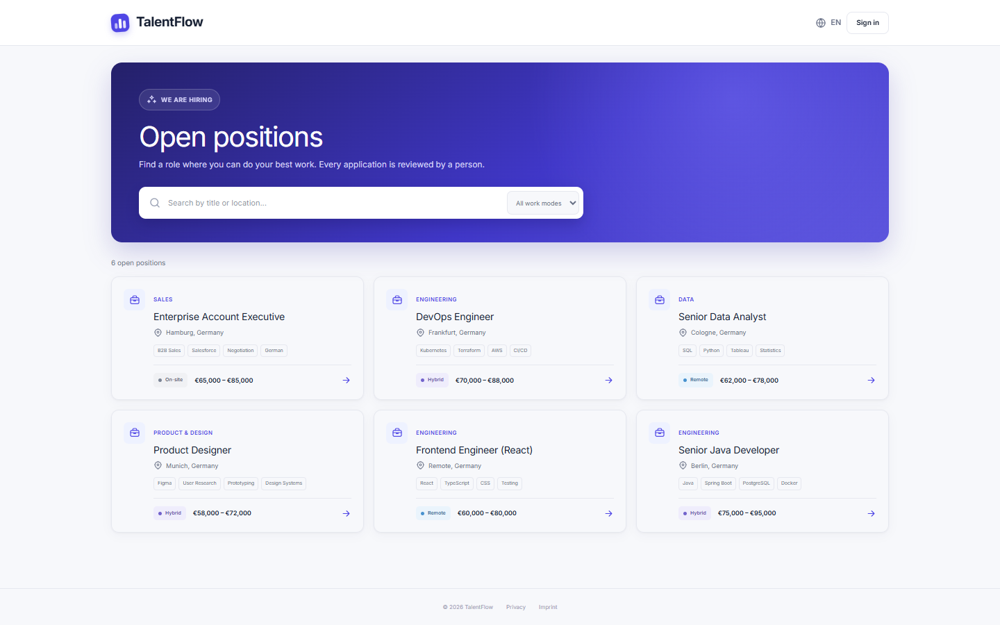 Public career page |
| 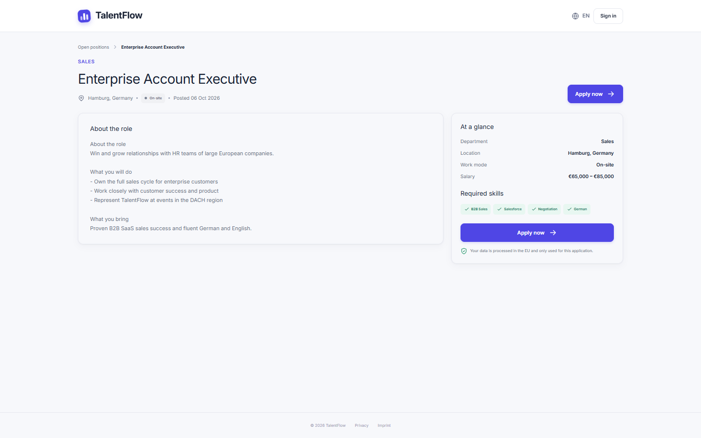 Job detail with "Apply now" | 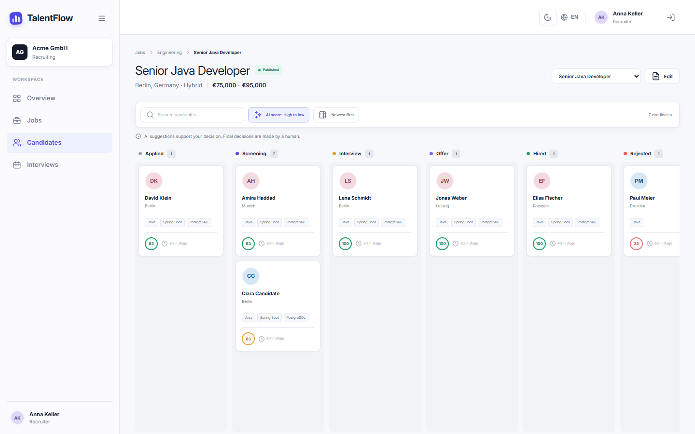 Kanban pipeline |
| 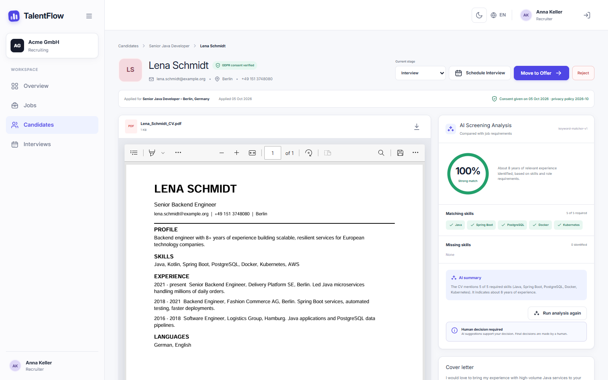 CV, AI analysis and stage controls | 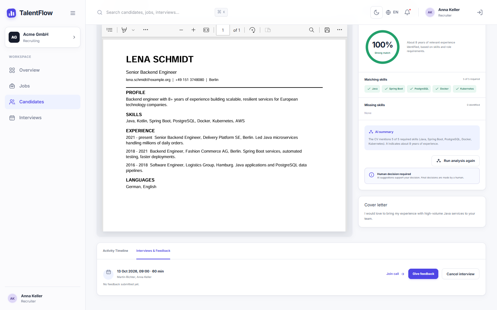 Interviews and feedback |
| 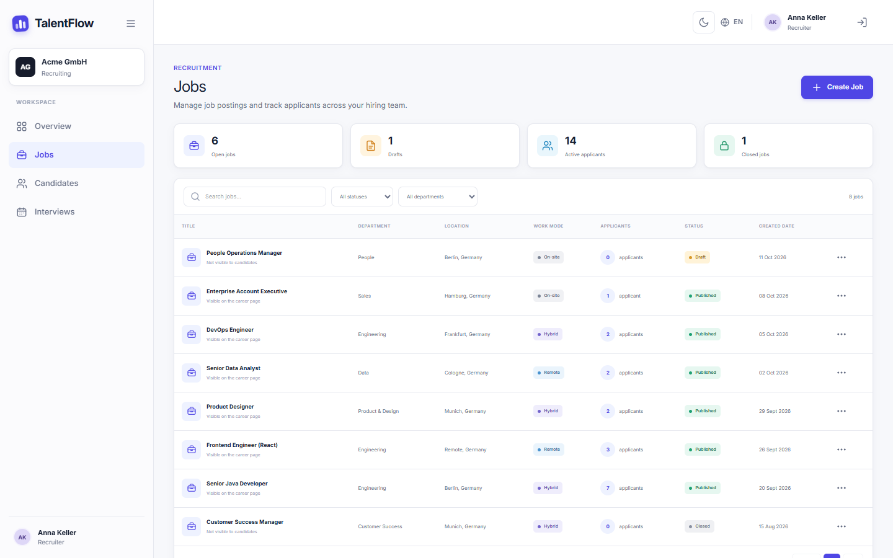 Jobs | 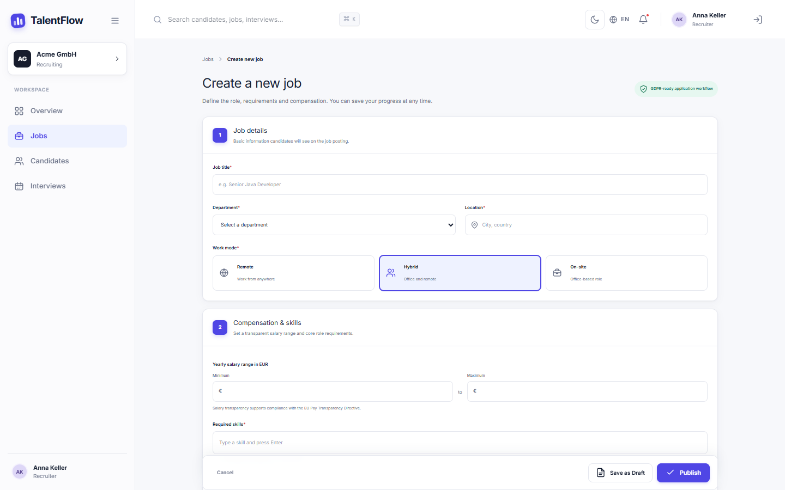 Create job |
| 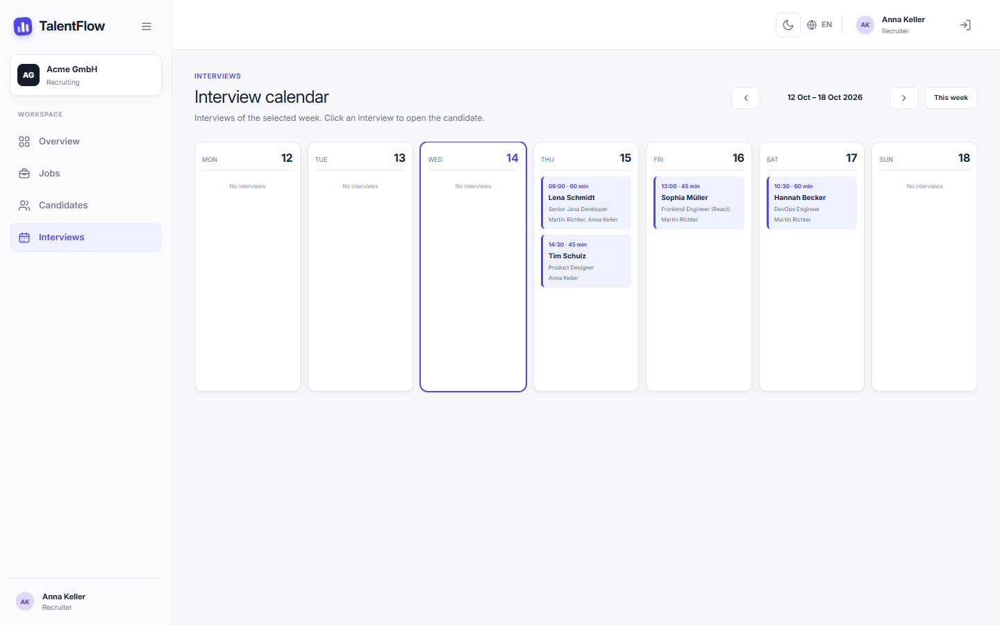 Interview calendar | 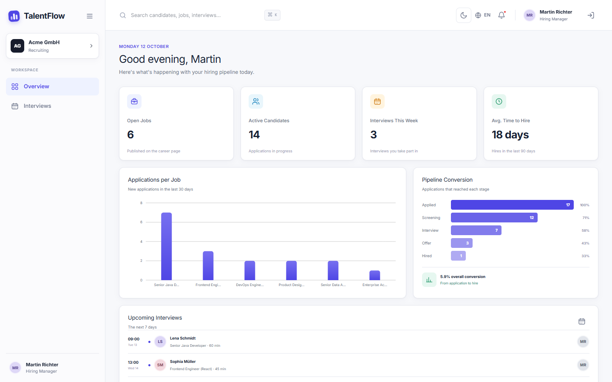 Hiring manager dashboard |
| 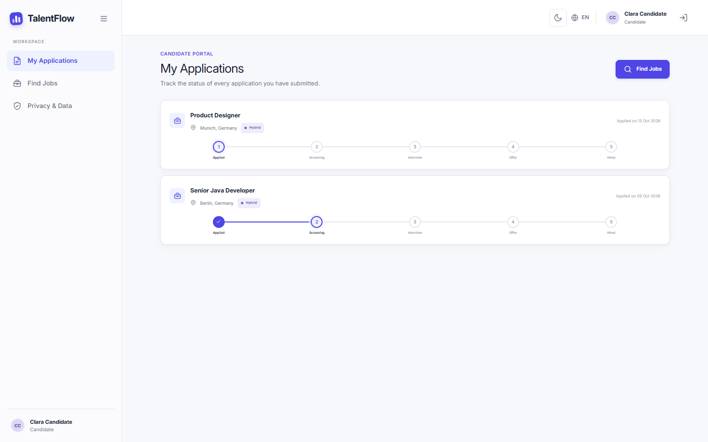 Candidate: my applications | 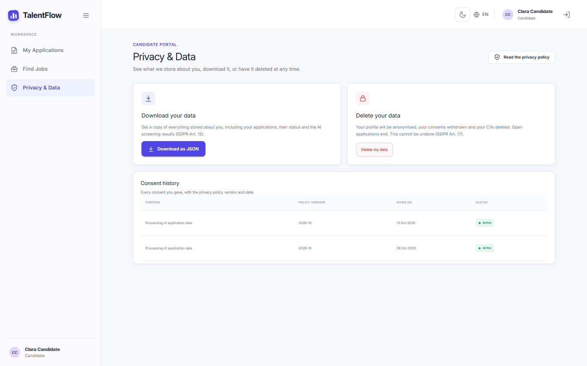 Candidate: privacy and data |
| 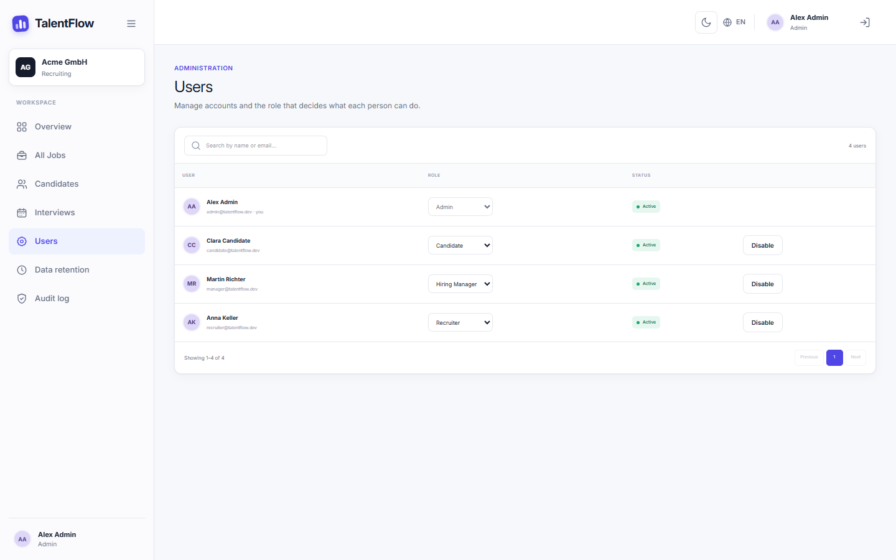 Admin: users and roles | 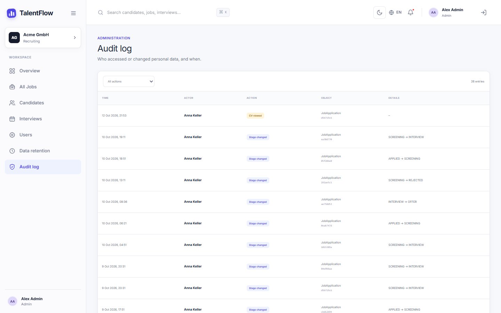 Admin: audit log |

## Limitations and next steps

- Erasure anonymises everything TalentFlow stores; the candidate's **Keycloak login account** itself is not
  deleted automatically (it can be removed in Keycloak, or Keycloak's own "delete account" feature can be enabled).
- Personal data redaction is pattern-based and best effort; names or contact data written in unusual ways can
  slip through.
- CVs are stored on a local volume; an S3-compatible adapter behind the existing `CvStorage` port would be the
  next step for multi-instance deployments.
- Scanned (image-only) PDFs contain no text, so their screening fails and is shown as such; OCR is not included.
- The Keycloak login page uses Keycloak's standard theme rather than the TalentFlow design.
