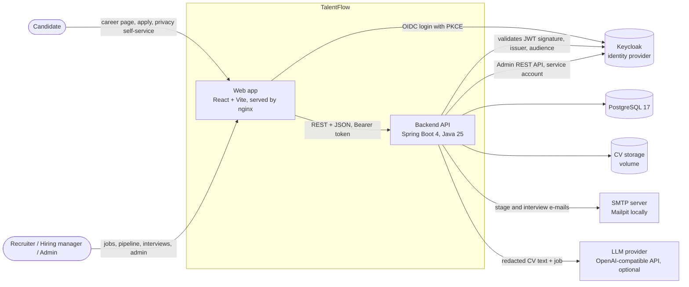
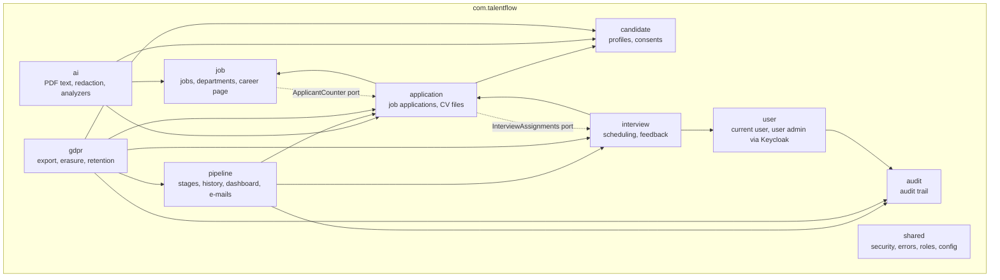
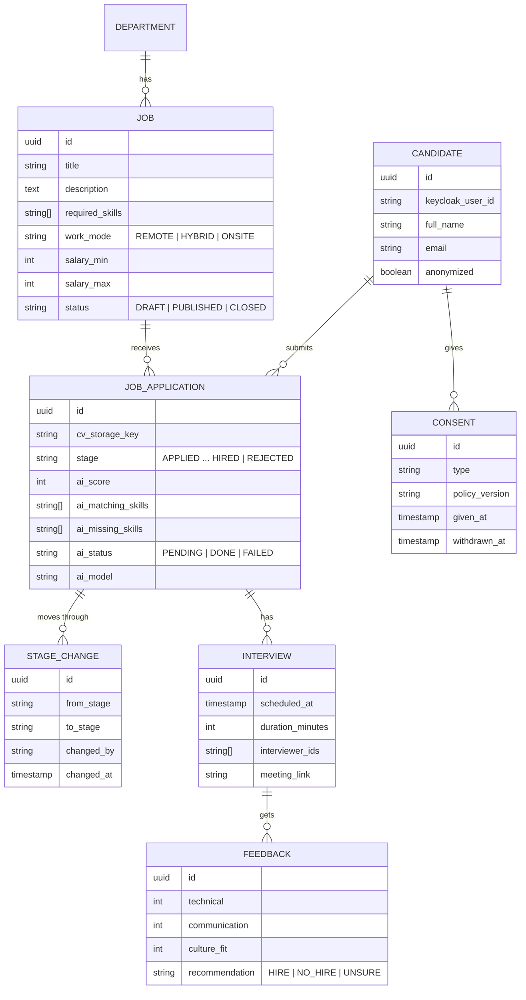
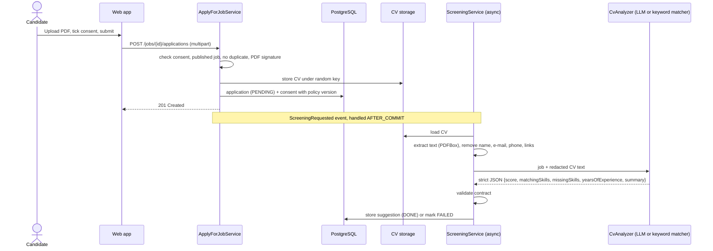
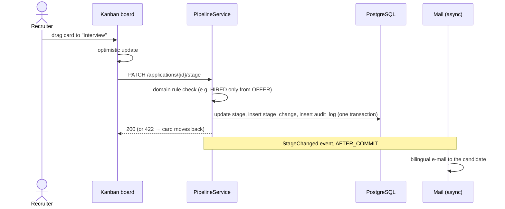

# TalentFlow architecture

This document describes how TalentFlow is put together: the runtime containers, the backend modules, the
data model and the most important flows. The diagrams are written in [Mermaid](https://mermaid.js.org/) and
render directly on GitHub.

## 1. System context

| Container | Port (local) | Responsibility |
|---|---|---|
| `frontend` | 3000 | nginx serves the built React app and proxies `/api` to the backend |
| `backend` | 8080 (`BACKEND_PORT`) | REST API, business rules, AI screening, e-mails, scheduled retention job |
| `keycloak` | 8180 | Login, self-registration, roles; realm imported from `infra/keycloak/realm-export.json` |
| `postgres` | 5432 | All application data; schema managed by Flyway |
| `mailpit` | 8025 / 1025 | Catches all outgoing e-mail in development |

## 2. Backend modules (hexagonal architecture)

Every module has the same three layers:

- `domain`: entities, value objects and rules, plus repository ports (interfaces). No web code.
- `application`: use cases (services), ports to other systems, events.
- `infrastructure`: adapters: REST controllers, JPA repositories, Keycloak and LLM clients, mail, files.

Dependencies always point inwards (infrastructure → application → domain). Where two modules would depend on
each other, the inner one defines a port and the outer one implements it, for example `ApplicantCounter`
(job → implemented by application) and `InterviewAssignments` (application → implemented by interview).

All modules use `shared` (roles, `CurrentUserProvider`, Problem Details error handling, security config).

## 3. Data model

`audit_log` (actor, action, entity, time, details) and `retention_policy` (single row) are standalone tables.

## 4. Key flows

### 4.1 Applying and AI screening

The screening runs after the application is committed, on a virtual thread, and never blocks or rolls back the
application. The LLM call happens outside a database transaction.

### 4.2 Moving a candidate in the pipeline

### 4.3 Right to erasure

`CandidateErasureService` is shared by the candidate's own request and the daily retention job:

1. Candidate profile: name, e-mail, phone, location and the link to the login account are replaced or removed.
2. Applications: CV reference, cover letter and AI output derived from the CV are cleared. Stage and dates stay
   so anonymous statistics (funnel, time to hire) remain correct.
3. Interviews and feedback: meeting links and free-text comments are cleared.
4. Consents are marked as withdrawn.
5. CV files are deleted **after** the transaction commits, so a rollback never loses a file.
6. An audit entry records who triggered the erasure (the candidate or the retention job).

## 5. Security model

- Login happens only at Keycloak (authorization code flow with PKCE). The web app never sees passwords.
- The backend is a stateless OAuth2 resource server. It checks signature, issuer and audience (`talentflow-api`)
  and maps Keycloak realm roles to Spring roles.
- Endpoints are protected with `@PreAuthorize`. Row-level rules live in the application layer, for example
  hiring managers only see applications they interview (`ApplicationAccessGuard`).
- Errors, including 401 and 403, are RFC 9457 Problem Details.
- User administration uses a separate confidential Keycloak client (service account) whose secret comes from the
  environment.

## 6. Concurrency

`JobApplication` is written by two parties: recruiters (stage) and the screening job (AI fields).

- The AI fields are excluded from optimistic locking, so a finishing screening never makes a stage change fail.
- Updates are dynamic (only changed columns), so neither side can overwrite the other's fields with stale values.
- The screening retries once if a stage change happened while it was saving.
